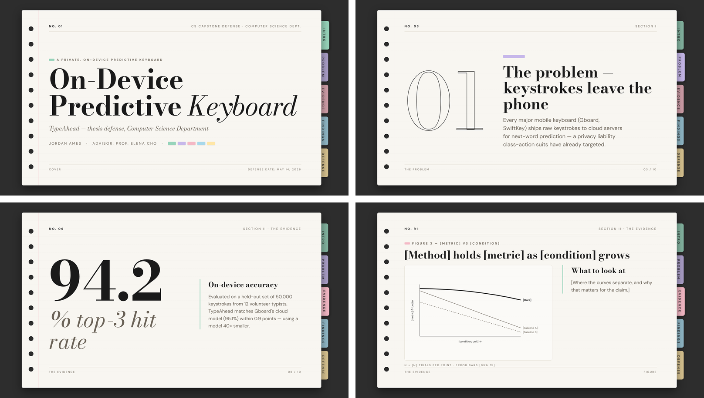
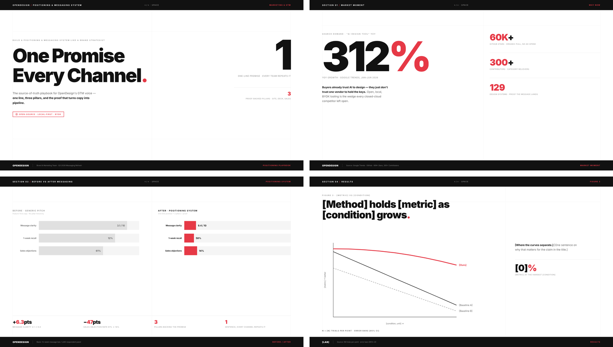
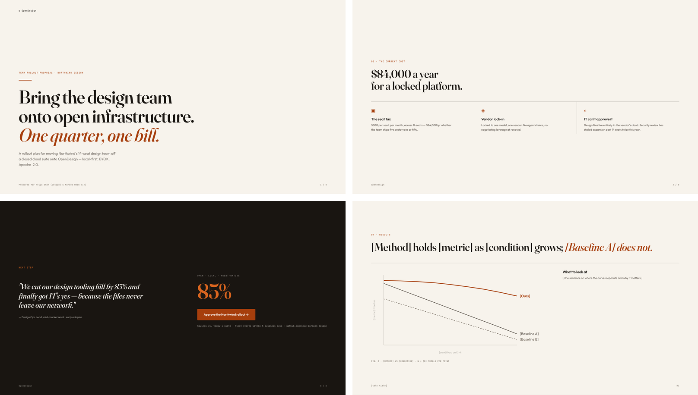
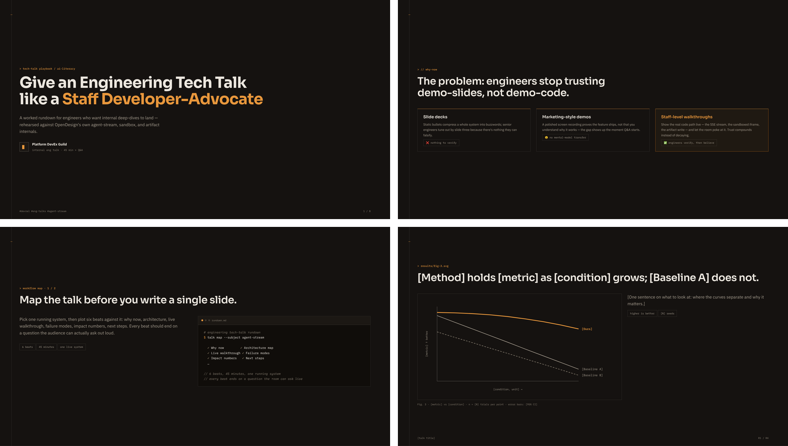
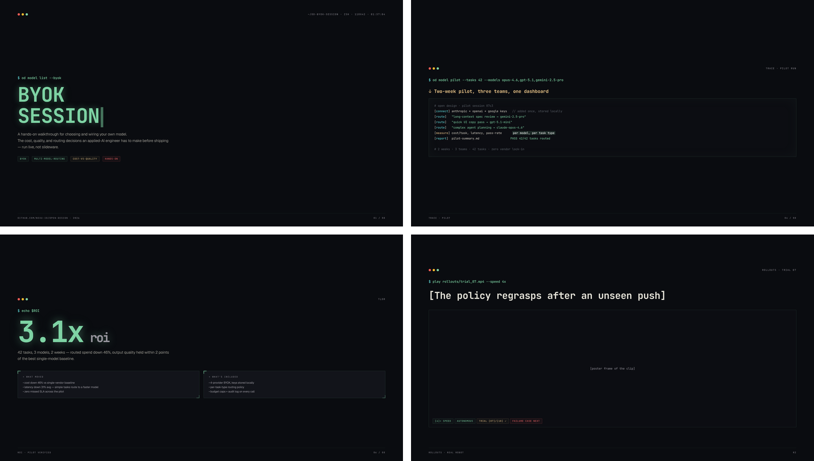

# Research Talk Crafter

Craft academic and research talks (conference, job talk, defense, lab meeting, lecture): talk structure, sentence-title slides, figure and robot-video rules, and five locked slide themes. Use when making or reviewing any research presentation or slide deck.

An agent plugin with one source tree, installable in **Claude Code**, **Cursor**,
**Codex**, **pi**, and **opencode**.

## What it does

- **Plans the talk** before any slide exists: talk type, the one-sentence message, and a slide
  plan with a sentence title, an evidence medium and a "do not say" line per slide.
- **Writes research slides**: one point per slide, sentence titles, figures redrawn for the
  talk, honest robot-video labels (speed, autonomy, trial counts), at most one equation per
  slide, and a close on contributions with backup slides.
- **Builds in one of five locked themes**: their fonts, px type scales, colour tokens and devices
  are kept exactly as shipped. Each theme also has research layouts (figure, robot video,
  equation, results table) built from its own tokens.
- **Doesn't pick your output format.** The agent builds an HTML deck, a .pptx file, Claude
  Slides, Codex slides or anything else; `references/porting.md` says how to carry a theme over.
  Animation, video and embeds are used only where the harness supports them.
- **Reviews the deck** in at most 3 rounds, with a linter that checks fonts and sizes against
  the theme's spec.

## Components

| Type | Name | Purpose |
|------|------|---------|
| Skill | `research-talk-crafter` | Talk craft, theme selection and use, porting, animation principles, review |
| Command | `/research-talk` | Thin entry point that runs the skill on `<topic or material>` |

```
skills/research-talk-crafter/
  SKILL.md
  references/   talk-craft.md (research synthesis + sources), animation.md, animation-research.md,
                porting.md, review-checklist.md
  themes/       specs.json + one folder per theme: example.html (seed), layouts.html (research
                slides), THEME.md (exact spec), UPSTREAM-SKILL.md, LICENSE files
  scripts/      lint_deck.py, check_contrast.py, render_math.mjs
```

## Themes

Five locked themes. Each preview shows three slides from the theme's seed deck and one of the
research slides added for this skill (figure, robot video, equation or results table). Bracketed text
on the research slides is placeholder content.

### Notebook Tabs  ·  `notebook-tabs`



**Use for:** thesis and capstone defenses, student talks, lectures. **Fonts:** Bodoni Moda + DM Sans. **Source:** [Zara Zhang](https://open-design.ai/plugins/example-fs-notebook-tabs/), MIT. [Spec](skills/research-talk-crafter/themes/notebook-tabs/THEME.md)

### Pentagram Grid  ·  `pentagram-grid`



**Use for:** results-heavy talks and benchmark comparisons ("ours" is the red bar). **Fonts:** Helvetica Neue. **Source:** [huashu / alchaincyf](https://open-design.ai/plugins/example-huashu-pentagram-grid/), MIT. [Spec](skills/research-talk-crafter/themes/pentagram-grid/THEME.md)
The preview was rendered on Linux, where Helvetica Neue isn't installed and a substitute sans is used; on macOS it renders in Helvetica Neue.

### Product Launch  ·  `product-launch`



**Use for:** job talks, invited talks, narrative openings. **Fonts:** Fraunces + Outfit + JetBrains Mono. **Source:** [lewislulu / Open Design](https://open-design.ai/plugins/example-html-ppt-product-launch/), MIT + Apache-2.0. [Spec](skills/research-talk-crafter/themes/product-launch/THEME.md)

### Tech Sharing  ·  `tech-sharing`



**Use for:** systems and robotics-software talks, code walkthroughs. **Fonts:** Sora + IBM Plex Sans + IBM Plex Mono. **Source:** [lewislulu / Open Design](https://open-design.ai/plugins/example-html-ppt-tech-sharing/), MIT + Apache-2.0. [Spec](skills/research-talk-crafter/themes/tech-sharing/THEME.md)

### Cyber Terminal  ·  `cyber-terminal`



**Use for:** live tooling and demo talks in dark rooms. **Fonts:** JetBrains Mono + Geist. **Source:** [lewislulu / Open Design](https://open-design.ai/plugins/example-html-ppt-hermes-cyber-terminal/), MIT + Apache-2.0. [Spec](skills/research-talk-crafter/themes/cyber-terminal/THEME.md)

The themes are vendored unmodified with their licences; see [`THIRD_PARTY.md`](THIRD_PARTY.md).
They are web-dense (body text 13–26px on a 1920×1080 canvas). Sizes are kept as shipped by
design; each THEME.md flags the small ones. Preview images are rendered at 1920×1080 in
headless Chrome from the files in `skills/research-talk-crafter/themes/`.

## Checking a deck

```bash
cd skills/research-talk-crafter
python3 scripts/lint_deck.py path/to/deck.html --theme notebook-tabs
python3 scripts/check_contrast.py "#f8f6f1" "#1a1a1a" "#6b6358"
npm install --no-save katex mathjax-full && node scripts/render_math.mjs --mathml '\mathcal{L} = ...'
```

## Installation

### Claude Code

```bash
claude plugin marketplace add DanielHou315/research-presentation-skill
claude plugin install research-talk-crafter@research-talk-crafter
```

### Cursor

Add this repository in Cursor's plugin settings — it reads
`.cursor-plugin/plugin.json` at the repo root.

### Codex

```bash
codex plugin marketplace add DanielHou315/research-presentation-skill
codex plugin add research-talk-crafter@research-talk-crafter
```

### pi

```bash
pi install git:github.com/DanielHou315/research-presentation-skill
```

Skills load as-is; commands become pi prompt templates (`/research-talk`).

### opencode

```bash
opencode plugin -g github:DanielHou315/research-presentation-skill
```

The adapter in `.opencode-plugin/` registers the skills, commands, agents, and
MCP servers. Append `#<tag>` to pin a version.

## Development

See [`docs/develop_plugin.md`](docs/develop_plugin.md). Before every commit:

```bash
scripts/gen_catalog.sh               # after editing a plugin.json
scripts/validate_plugin.sh --strict
```

---

Built with [multi-harness-plugin-template](https://github.com/DanielHou315/multi-harness-plugin-template).
